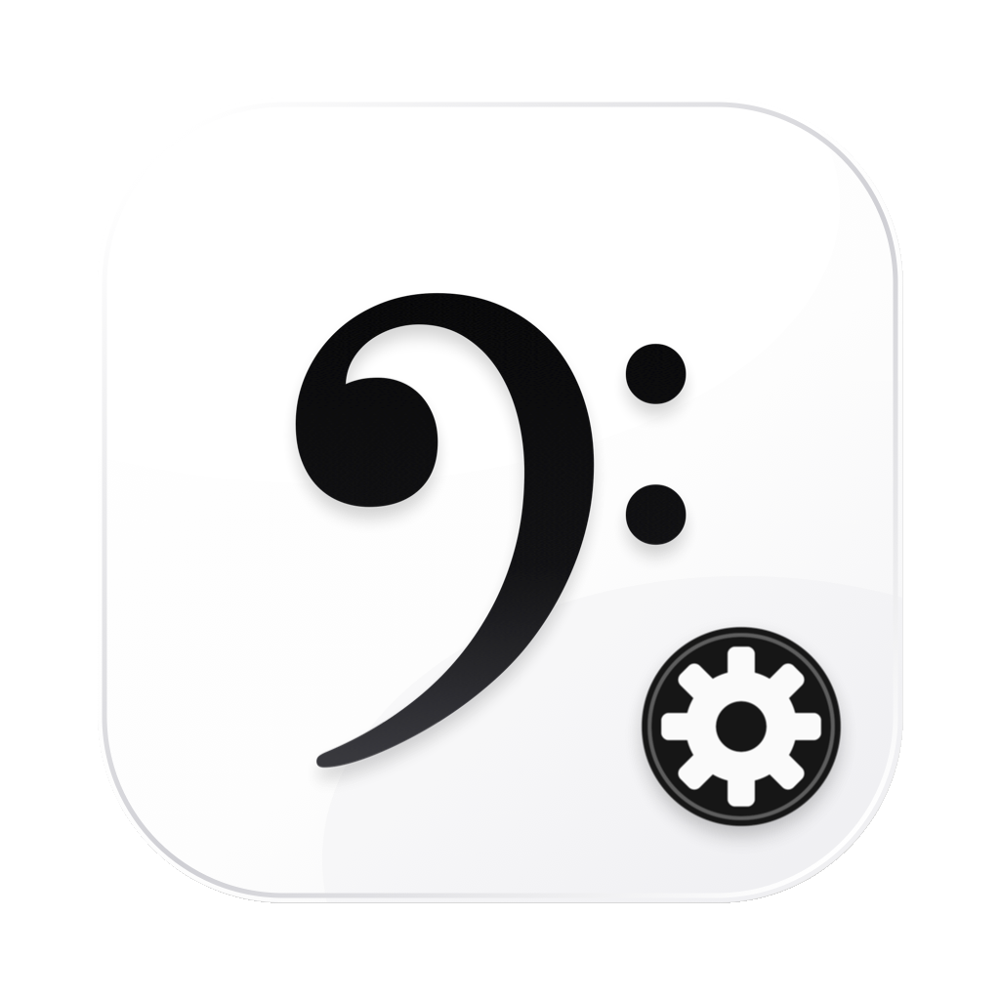

# Apple Music 音乐信息订正

[](#系统要求)
[](#从源码构建)
[](LICENSE)

一个轻量的 macOS 原生工具，用于检查 Apple Music 资料库中新增歌曲的名称与专辑信息，并在匹配可信时自动修正。

> 本项目与 Apple Inc. 无隶属关系。“Apple Music”仅用于说明兼容的应用程序。



## 功能

- 打开后自动扫描新增歌曲。
- 使用 Apple 日本区曲库查询官方歌曲与专辑信息。
- 专辑匹配失败时，自动使用“歌曲名 + 艺人”进行二次搜索。
- 将本地内嵌封面与候选专辑封面做感知哈希比较，降低同曲不同专辑的误匹配。
- 同时支持英文、日文和中文作品，并尽量保留作品原本的官方语言。
- 支持中文简体、繁体及全角、半角字符之间的比较。
- 识别专辑被艺人名、专辑名或大小写差异拆开的情况。
- 修改前自动备份，可在应用中一键撤销。
- 分别显示：
  - 本次更改
  - 需要处理
  - 已经正确／非日文作品
- 仅修改元数据，不复制、移动或删除音乐文件。

## 系统要求

- macOS 14 Sonoma 或更高版本
- Apple Music 音乐 App
- 首次运行需要授予“控制音乐”自动化权限
- 联网访问 Apple iTunes Search API

## 安装

1. 从 [Releases](https://github.com/RamielTRBX/apple-music-metadata-fixer/releases) 下载最新的 DMG。
2. 打开 DMG。
3. 将 `Apple Music 音乐信息订正.app` 拖入“应用程序”文件夹。
4. 首次启动时允许该应用控制“音乐”。

本地构建的应用使用 ad-hoc 签名，未经过 Apple 公证。

## 使用

1. 打开 `Apple Music 音乐信息订正.app`。
2. 软件自动读取最近新增的歌曲并开始联网匹配。
3. 检查“本次更改”“需要处理”和“已经正确／非日文作品”三个区域。
4. 如需恢复，点击“撤销上次修改”。

首次运行检查最近 7 天新增的歌曲。后续运行从上次成功扫描时间继续，并重试之前未能确认的歌曲。

## 匹配原则

- 只有艺人、专辑、曲序和时长足够吻合时，才自动修改。
- 本地和候选封面同时存在时，明显不同的封面会直接排除候选版本。
- 不根据歌词语言判断歌曲标题语言。
- 日文歌曲使用日文正式标题，即使歌词是英文。
- 英文歌曲保留英文标题，中文歌曲保留中文标题。
- 简体与繁体标题只用于等价比较，不强制改变现有字形。
- 无法可靠确认时保持原样，不进行猜测性修改。

## 隐私

- 不上传音频文件。
- 不需要 Apple Music、Discogs 或其他账号。
- 联网查询只发送用于查找作品的艺人、专辑或歌曲名。
- 本地状态和备份位于：

  `~/Library/Application Support/AppleMusicMetadataFixer/`

## 从源码构建

要求安装 Xcode 或匹配版本的 macOS Command Line Tools。

```sh
./scripts/build_app.sh
```

构建产物为 `Apple Music 音乐信息订正.app`。

重新生成图标：

```sh
python3 ./scripts/generate_icon.py
```

`generate_icon.py` 需要 Pillow、NumPy、ImageMagick 以及 macOS Quick Look 工具。

## 项目结构

```text
Sources/AppleMusicMetadataFixer/
  AppModel.swift            扫描、匹配和撤销流程
  ContentView.swift         SwiftUI 界面
  ITunesClient.swift        Apple 日本区曲库查询
  MetadataMatcher.swift     匹配与语言保护规则
  MusicAutomation.swift     Apple Music 自动化桥接
  Storage.swift             状态和备份
  Resources/
    music_read.js           读取新增歌曲
    music_apply.js          写入元数据
    curated_rules.json      已核对的别名与语言规则
    AppIcon.svg             图标源文件
    AppIcon.icns            应用图标
scripts/
  build_app.sh
  generate_icon.py
```

## 参与贡献

请阅读 [CONTRIBUTING.md](CONTRIBUTING.md)。提交问题前请先搜索现有 Issues，并移除个人音乐资料、路径和账户信息。

## 安全

请勿在公开 Issue 中提交 Apple ID、凭证、个人资料库导出或未脱敏日志。安全问题的报告方式见 [SECURITY.md](SECURITY.md)。

## 许可证

[MIT](LICENSE)
